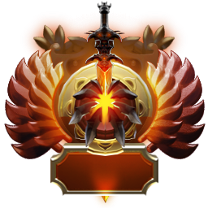
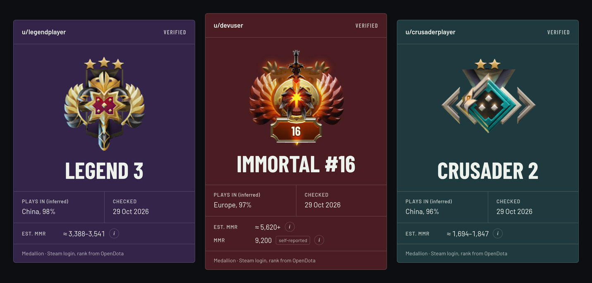

<p align="center">
  
</p>

<h1 align="center">Dewarded</h1>

<p align="center">
  <strong>Prove your Dota 2 medal on Reddit.</strong><br>
  Sign in with Steam, get a page that shows your verified rank, and link it from your Reddit profile.
</p>

<p align="center">
  <a href="LICENSE"></a>
  <a href="https://tanstack.com/start"></a>
  <a href="https://react.dev"></a>
  <a href="https://www.typescriptlang.org"></a>
  <a href="https://turso.tech/libsql"></a>
  <a href="https://fly.io"></a>
  <a href="https://www.opendota.com"></a>
</p>

<p align="center">
  
</p>

## Why a screenshot is not enough

Dota subreddits have a lot of confident gameplay advice. Some of it comes from players whose advice works only in their own bracket. Dewarded lets a player show their real medal with one link, instead of a screenshot anyone can fake.

## How a page ties a medal to a Reddit name

Dewarded runs in backlink mode unless you set `VERIFY_MODE=reddit`. In backlink mode, you get a page in five steps.

1. **Steam login proves which Steam account you own.** You sign in on `steamcommunity.com`. Dewarded sends Steam's response back to Steam's own server and trusts it only after Steam confirms it.
2. **OpenDota supplies the medal.** It also supplies the Immortal leaderboard rank and the server region where you play the most ranked games. Dewarded first asks OpenDota to refresh the account from Valve, then reads these values.
3. **You type your Reddit username.** Dewarded shows the name on your page as a claim. Dewarded cannot check that you own the name.
4. **Dewarded creates your page at `/p/<id>`.** The id is 10 random characters and never contains your Steam ID. The page shows a card colored by your medal tier, and link previews show the medal.
5. **You link the page from your Reddit profile.** The link goes under social links or in the about text. A reader who doubts you opens your Reddit profile and checks that it links to your page. Only the owner of a Reddit account can edit its profile, so that backlink ties the medal to the Reddit name.

The medal is verified. The Reddit name is a claim until a reader checks the backlink, and the page marks the name as claimed.

### Reddit login mode replaces the claim with a login

Reddit login mode is optional. It needs Reddit API access, which Reddit has to grant to Dewarded, and `VERIFY_MODE=reddit` turns it on. The player logs in with Reddit first, and the `identity` scope proves the username. Steam login then proves the Steam account. The page address is `/u/<reddit-name>`, and there is no claim step. Both `/u/` and `/p/` pages keep working in either mode.

## Where each card field comes from

This table lists each field on the card, where its value comes from, and whether Dewarded verifies it.

| Field | Source | Status |
| --- | --- | --- |
| Medal and stars | OpenDota `rank_tier` | Verified |
| Reddit name, backlink mode | Typed in by the player. Readers confirm it through the link on the player's Reddit profile. | Claimed |
| Reddit name, reddit mode | Reddit login with the `identity` scope | Verified |
| Immortal leaderboard rank | OpenDota `leaderboard_rank` | Verified |
| Region | The server region with the most ranked games, from OpenDota match counts | Inferred |
| Est. MMR | The usual range for the medal, from Liquipedia | Estimate |
| MMR | Typed in by the player. Immortal only, from 5,620 to 20,000. | Self-reported |

Valve does not publish numeric MMR, so no outside site can verify an MMR number. The card tags the region **(inferred)**, labels the range **Est. MMR**, and tags a typed MMR **self-reported**.

## What Dewarded stores and shows

This list covers the main points. The site's `/privacy` page has the full list.

- Dewarded stores nothing until you sign in through Steam and enter a Reddit username. In reddit mode, it stores nothing until you finish both the Reddit login and the Steam login.
- Public pages never show the Steam account. A public page receives only the medal and leaderboard rank, the region, the check date, the Reddit name, and the optional self-reported MMR.
- In backlink mode, Dewarded never connects to your Reddit account. In reddit mode, Dewarded uses the Reddit token once to read your username and does not keep the token.
- One button deletes everything. **Delete all my data and log out** on `/me` removes your record and your public page, then logs you out.

## Run Dewarded locally

Install the dependencies, copy the example environment, and start the dev server.

```bash
pnpm install
cp .env.example .env
pnpm dev
```

Open http://localhost:3000. Steam login and OpenDota need no keys.

To try reddit mode, set `VERIFY_MODE=reddit` in `.env`. If `REDDIT_CLIENT_ID` is empty, a form marked as a dev-only fake login replaces the Reddit login. Production builds always disable that form.

## Environment variables

`src/server/config.ts` reads these variables, and `.env.example` lists them. Production means `NODE_ENV=production`, which the `Dockerfile` sets.

| Variable | Value | Development default |
| --- | --- | --- |
| `VERIFY_MODE` | `backlink` or `reddit`. Any other value throws an error when the config loads. | `backlink` |
| `PUBLIC_URL` | The origin the site is served from, with no trailing slash. Dewarded builds the Steam OpenID and Reddit OAuth callback URLs, the page link, and the link-preview image URL from it. Required in production. | `http://localhost:3000` |
| `SESSION_SECRET` | 32 or more random bytes, such as the output of `openssl rand -hex 32`. It signs the session cookie. Required in production. | A new random secret on each start, so sessions end on restart |
| `DATABASE_URL` | A libSQL URL. It is either a local SQLite file, such as `file:./data/dewarded.db`, or `libsql://<db>.turso.io` for Turso. | `file:./data/dewarded.db` |
| `DATABASE_AUTH_TOKEN` | The auth token for Turso. Only a remote libSQL database needs it. | None |
| `REDDIT_CLIENT_ID` | The client ID of the Reddit app. Reddit mode only. | None |
| `REDDIT_CLIENT_SECRET` | The client secret of the Reddit app. Reddit mode only. | None |

Reddit mode needs a Reddit app of type **web app**, created at [Reddit's app preferences](https://www.reddit.com/prefs/apps). The app's redirect URI is `<PUBLIC_URL>/auth/reddit/callback`.

## Development scripts

Each command runs from the repository root.

| Script | What it does |
| --- | --- |
| `pnpm test` | Runs every `src/**/*.test.ts` file with `node --test`, loading TypeScript through `tsx` |
| `pnpm typecheck` | Runs `tsc --noEmit`. A new route fails the check until `pnpm dev` or `pnpm build` regenerates the route tree types in `src/routeTree.gen.ts`. |
| `pnpm seed-claim <reddit-name> <steamId64>` | Creates or renames a backlink-mode claim through the same code as the claim form, with no login, and prints the claim |
| `pnpm seed <reddit-name> <steamId64>` | Links a reddit-mode account through the same OpenDota check as the Steam callback, with no login, and prints the record |
| `pnpm build && pnpm start` | Builds and runs the production server |
| `BASE=<origin> scripts/verify-steam-forgery.sh <cookie-jar> <db>` | Sends seven forged Steam callbacks to a running dev server and prints the database row counts before and after. Each forgery starts its own Steam login first, so it carries a valid session nonce, except the two that test a missing or foreign nonce. `BASE` defaults to `http://localhost:3000`. In backlink mode, the jar can be `/dev/null`. In reddit mode, the jar must hold a session that logged in through Reddit. The script needs the `sqlite3` CLI. |

## Where the code lives

This table lists the main paths, not every file.

| Path | Role |
| --- | --- |
| `src/domain.ts` | Types and pure functions for medal parsing, tier colors, MMR ranges, and region picking. It imports no framework code. |
| `src/server/opendota.ts` | The only code that calls OpenDota and reads its raw `rank_tier` |
| `src/server/db.ts` | The only code in `src/` that touches the database |
| `src/server/config.ts` | Reads the environment once, including `VERIFY_MODE` |
| `src/server/steam.ts`, `src/server/reddit.ts` | The two login protocols, Steam OpenID 2.0 and Reddit OAuth |
| `src/routes/auth.*`, `src/routes/api.*` | Server-only route handlers. The CSRF middleware in `src/start.ts` rejects cross-site POSTs. |
| `server.mjs` | The production server. It serves `dist/client` and the built app with srvx, adds the security headers to every response, and logs each request's method, path, status, and time, never its query string. |
| `src/components/` | The medal card, the medal badge, the copy-link button, the info popover, and the forms for the Reddit name and the MMR |

## Deploy to Fly.io

Dewarded runs as one Fly machine and keeps the SQLite file on a Fly volume mounted at `/data`.

Edit `app`, `primary_region`, and `PUBLIC_URL` in `fly.toml`. Then run these commands, with your `primary_region` value as `<region>`.

```bash
fly apps create <app>
fly volumes create dewarded_data --size 1 --region <region>
fly secrets set SESSION_SECRET=$(openssl rand -hex 32)
fly deploy
```

To deploy in reddit mode, also set `VERIFY_MODE=reddit`, `REDDIT_CLIENT_ID`, and `REDDIT_CLIENT_SECRET`. Set the Reddit app's redirect URI to `<PUBLIC_URL>/auth/reddit/callback`.

## Why refresh is owner-only with a one-hour cooldown

OpenDota's free tier allows 60 calls a minute and 3,000 calls a day per server IP. Each medal check costs three calls. The first is a refresh request that asks OpenDota to fetch the medal from Valve again. Dewarded then fetches the player record and the ranked match counts in parallel.

At three calls a check, the daily quota covers about 1,000 checks for the whole site. That budget is why only the page owner can refresh, and at most once an hour.

OpenDota processes the refresh request in the background. A check can still show the previous medal, and the next refresh picks up the new one.

## License and credits

The code is under the [MIT license](LICENSE). The data and images come from these sources.

- Rank data comes from the [OpenDota API](https://docs.opendota.com).
- MMR estimates come from [Liquipedia](https://liquipedia.net/dota2/Matchmaking/Seasonal_Rankings), under CC BY-SA 3.0. The Immortal floor of 5,620 is not a Liquipedia number. Dewarded infers it from Liquipedia's Divine 5 value.
- The medal images in `public/medals/` belong to Valve and come from [OpenDota's web repo](https://github.com/odota/web). The MIT license does not cover them.
- The Barlow and Barlow Condensed fonts in `public/fonts/` are by the Barlow Project Authors and come from [Google Fonts](https://fonts.google.com/specimen/Barlow). They are under the SIL Open Font License 1.1, in [`public/fonts/OFL.txt`](public/fonts/OFL.txt).

Dewarded is not affiliated with Valve. Dota 2 is a trademark of Valve Corporation.
